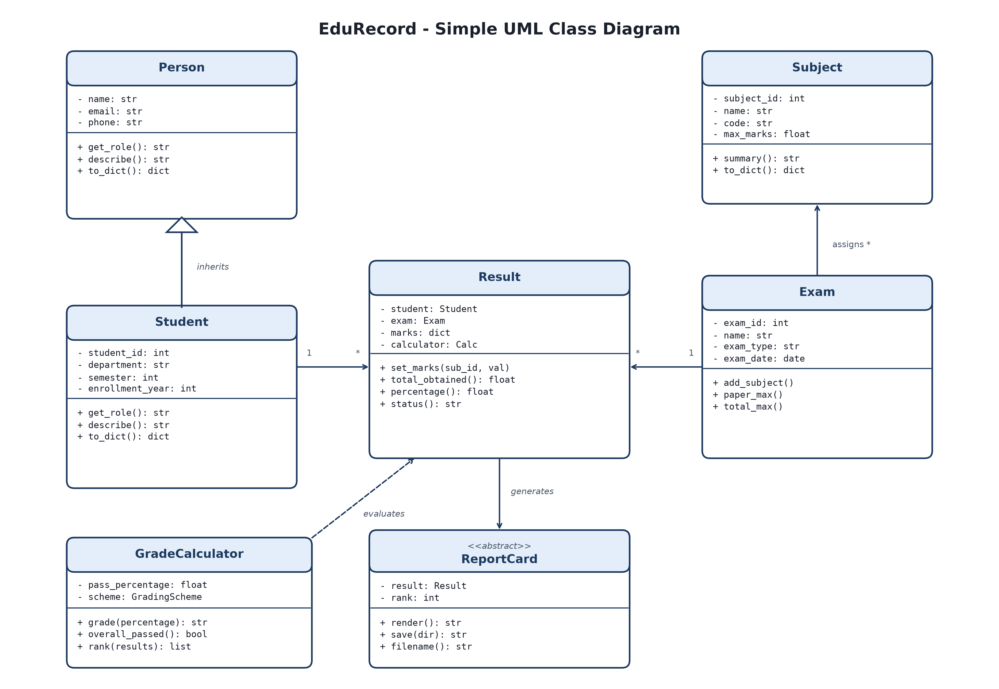

# Student Exam and Grade Management System
Project Documentation

## 1. Project Title and Problem Statement
**Title:** Student Exam and Grade Management System

**Problem Statement:**
Handling student marks, calculating percentages, and making report cards by hand is slow and easy to mess up. Common issues include typing marks higher than the allowed maximum, making math errors in totals, and figuring out class ranks when multiple students get the same score.

This project provides a simple terminal-based system to store students, subjects, exams, and marks in a local SQLite database. It automatically calculates percentages and grades, handles ranks with ties, and exports report cards as text or CSV files.

## 2. Objectives
- Add, update, view, and delete students, subjects, and exams.
- Enter and update marks with validation (prevents negative marks or marks above the maximum).
- Calculate total marks, percentages, pass/fail status, and letter grades automatically.
- Rank students fairly using competition ranking (tied students get the same rank).
- Save individual report cards and exam merit lists to text and CSV files.
- Keep all data saved locally in an SQLite database file.

## 3. UML Class Diagram


How the main classes connect:
- `Person`: Base class storing name, email, and phone.
- `Student`: Inherits from `Person`, adding student ID, department, and semester.
- `Subject`: Holds subject details and maximum marks.
- `Exam`: Holds the exam details and assigned subjects.
- `Result`: Combines a student, an exam, and the marks scored.
- `GradeCalculator`: Computes grades, pass/fail, and student ranks.
- `ReportCard`: Base class to generate text or CSV report cards.

## 4. Code Structure
- `models.py`: Defines the classes for people, students, subjects, exams, and results.
- `database.py`: Handles saving and loading records from SQLite.
- `grading.py`: Grade scale rules, pass percentage, and ranking logic.
- `reports.py`: Creates report cards and merit lists.
- `cli.py`: Console menus and user input handling.
- `main.py`: Entry point to run the program.
- `errors.py`: Custom error classes.
- `seed_data.py`: Loads sample data for testing.
- `test_system.py`: Automated unit tests.

## 5. OOP Concepts Used
- **Classes & Objects:** Used for all data models (students, subjects, exams, results).
- **Inheritance:** `Student` inherits common fields from `Person`.
- **Method Overriding:** `Student` overrides `describe()` and `get_role()` from `Person`.
- **Encapsulation:** Private and protected attributes with properties to validate inputs (e.g. valid semester, non-negative marks).
- **Polymorphism & Abstraction:** Abstract base classes for `Entity`, `GradingScheme`, and `ReportCard`. `TextReportCard` and `CsvReportCard` both implement their own `render()` method.
- **Exception Handling:** Custom `ValidationError` catches bad input in the menu without crashing the app.
- **File Handling:** Saves data to `exam_system.db`, and outputs `.txt` and `.csv` files in the `reports/` folder.

## 6. How to Run
```bash
# load sample data
python seed_data.py

# start program
python main.py

# run unit tests
python -m unittest test_system.py
```

## 7. Sample Outputs

### Main Menu
```text
===== MAIN MENU =====
  1. Student Management
  2. Subject Management
  3. Examination Management
  4. Marks & Results
  5. Rankings / Merit List
  6. Report Cards
  7. Grading Settings
  0. Exit
```

### Sample Report Card (`reports/report_card_S1_E1.txt`)
```text
============================================================================
                            STUDENT REPORT CARD                             
============================================================================
Exam       : Semester 3 Final Examination (Final) - 10 Dec 2026
Student ID : 1
Name       : Aarav Sharma
Department : Computer Science    Semester: 3
----------------------------------------------------------------------------
Code      Subject                        Max   Marks       %  Grade  Result
----------------------------------------------------------------------------
CS201     Data Structures                100      92   92.00     A+    PASS
CS202     Database Systems               100      88   88.00      A    PASS
CS203     Operating Systems              100      95   95.00     A+    PASS
CS204L    Programming Lab                 50      47   94.00     A+    PASS
MA201     Mathematics III                100      90   90.00     A+    PASS
----------------------------------------------------------------------------
Total Marks : 412 / 450
Percentage  : 91.56%
Grade       : A+
Rank        : 1 of 6
Overall     : PASS
============================================================================
```

## 8. Test Results
The test suite in `test_system.py` runs 14 automated tests covering validation, grade calculations, ranking ties, and database operations.

```text
Ran 14 tests in 0.030s

OK
```
